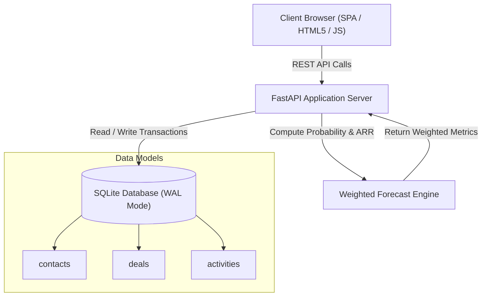

# ClientSphere | Enterprise B2B CRM & Weighted Revenue Pipeline Engine

[](https://github.com/Soulofghost/clientsphere/actions)
[](LICENSE)
[](https://www.python.org/)
[](https://fastapi.tiangolo.com/)
[](https://www.sqlite.org/)

---

## 1. Project Introduction

**ClientSphere** is a high-performance customer relationship management (CRM) and sales pipeline intelligence platform designed for enterprise B2B sales teams, solutions architects, and executive leaders. Built with a FastAPI backend and a clean, responsive single-page architecture, ClientSphere combines account interaction logging with automated, probability-weighted ARR forecasting.

---

## 2. Problem Statement

Mid-market and enterprise organizations frequently suffer from disconnects between pipeline estimates and realized revenue:
- **Distorted Revenue Projections:** Unweighted deals skew forecasts by treating top-of-funnel opportunities equally with late-stage contracts.
- **Fragmented Account History:** Crucial interactions (calls, meetings, strategy notes) are scattered across emails and disconnected spreadsheets.
- **Cluttered SaaS Interfaces:** Existing CRM suites carry prohibitive overhead, excessive navigation depth, and sluggish load times.

---

## 3. Proposed Solution

ClientSphere resolves these challenges by introducing:
- **Dynamic Probability Weighting:** Automatic calculation of realizable ARR based on verified deal progression stages (Qualified 20%, Meeting 35%, Proposal 60%, Negotiation 80%, Closed Won 100%).
- **Unified Account & Deal Graph:** Relational mapping linking enterprise contacts directly to active contracts and chronological audit trails.
- **Single-Screen Pipeline Funnel:** Real-time visual Kanban board allowing instantaneous stage transitions and search filtering.

---

## 4. Key Features

- **Executive KPI Dashboard:** Real-time computation of Total Pipeline Value, Weighted Realizable ARR, Closed-Won Contract Value, and Historical Win Rate.
- **Multi-Stage Kanban Pipeline:** 6 distinct stages with automatic probability recalibration and interactive transitions.
- **B2B Contact Directory:** Account management tracking corporate stakeholders, decision makers, email addresses, and direct phone lines.
- **Chronological Audit Trail:** Comprehensive activity tracking for phone calls, executive meetings, email communications, and strategy notes.
- **Zero-Latency Search:** Instant client-side filtering across deal names, accounts, and stakeholders.

---

## 5. Architecture Diagram



---

## 6. Technology Stack

- **Backend:** Python 3.11+, FastAPI, Pydantic v2, Uvicorn
- **Database:** SQLite 3 with Write-Ahead Logging (WAL mode)
- **Frontend:** Vanilla TypeScript-ready ES6, HTML5, Custom CSS with Plus Jakarta Sans & JetBrains Mono typography
- **DevOps:** Docker, Docker Compose, GitHub Actions CI
- **Testing:** Pytest, HTTPX TestClient

---

## 7. Folder Structure

```
clientsphere/
├── .github/
│   └── workflows/
│       └── ci.yml
├── backend/
│   ├── app/
│   │   ├── engine/
│   │   │   ├── __init__.py
│   │   │   └── forecast.py
│   │   ├── routers/
│   │   │   ├── __init__.py
│   │   │   ├── activities.py
│   │   │   ├── contacts.py
│   │   │   └── deals.py
│   │   ├── __init__.py
│   │   ├── config.py
│   │   ├── database.py
│   │   ├── main.py
│   │   └── schemas.py
│   ├── data/
│   ├── tests/
│   │   ├── __init__.py
│   │   ├── test_api.py
│   │   └── test_forecast.py
│   └── requirements.txt
├── frontend/
│   ├── app.js
│   ├── index.html
│   └── style.css
├── .env.example
├── .gitignore
├── docker-compose.yml
├── Dockerfile
├── LICENSE
└── README.md
```

---

## 8. Installation Instructions

### Prerequisites
- Python 3.11 or later (or `uv` package manager)
- Git

### Setup Steps
```bash
git clone https://github.com/Soulofghost/clientsphere.git
cd clientsphere

# Option A: Using uv (Fast)
uv venv
source .venv/bin/activate  # Or .venv\Scripts\activate on Windows
uv pip install -r backend/requirements.txt

# Option B: Standard pip
python -m venv venv
source venv/bin/activate
pip install -r backend/requirements.txt
```

---

## 9. Environment Configuration

Copy `.env.example` to `.env`:
```bash
cp .env.example .env
```

| Variable | Default Value | Description |
| :--- | :--- | :--- |
| `PORT` | `8005` | HTTP server port |
| `CLIENTSPHERE_DB` | `./backend/data/clientsphere.db` | SQLite database file location |
| `APP_ENV` | `development` | Runtime environment flag |

---

## 10. Database Setup

Database initialization and initial enterprise demo records are seeded automatically on first startup via SQLite WAL mode:
```bash
python -c "from backend.app.database import init_db; init_db()"
```

---

## 11. API Documentation

When the application is running, full interactive OpenAPI docs are accessible at:
- Swagger UI: `http://localhost:8005/docs`
- ReDoc: `http://localhost:8005/redoc`

### Primary Endpoints

| Method | Endpoint | Description |
| :--- | :--- | :--- |
| `GET` | `/api/v1/health` | Service health status check |
| `GET` | `/api/v1/contacts` | List enterprise contacts |
| `POST` | `/api/v1/contacts` | Register a new account contact |
| `DELETE` | `/api/v1/contacts/{id}` | Remove contact record |
| `GET` | `/api/v1/deals` | Retrieve deals with stage filters |
| `POST` | `/api/v1/deals` | Create opportunity with auto-weighting |
| `PATCH` | `/api/v1/deals/{id}/stage` | Advance deal stage and recalibrate metrics |
| `DELETE` | `/api/v1/deals/{id}` | Delete deal record |
| `GET` | `/api/v1/deals/metrics/forecast` | Computed pipeline forecast metrics |
| `GET` | `/api/v1/activities` | Filter activity audit trail |
| `POST` | `/api/v1/activities` | Record phone call, meeting, or note |

---

## 12. Application Interface Overview

ClientSphere features a purpose-built B2B UI:
- **Top Bar:** Quick access to contact management and deal creation.
- **KPI Metrics:** Immediate visibility into pipeline health.
- **Kanban Columns:** Responsive multi-stage layout with inline probability progression.
- **Activity Drawer:** Modal view for interaction auditing without page reloading.

---

## 13. Testing Instructions

Execute the automated test suite covering unit forecasting models and full API integration flows:

```bash
# Using pytest
cd backend
pytest tests/ -v

# Or using uv runner
uv run --with fastapi --with pydantic --with pytest --with httpx pytest backend/tests/ -v
```

Expected output:
```
tests/test_api.py::test_health PASSED
tests/test_api.py::test_contact_lifecycle PASSED
tests/test_api.py::test_deal_and_forecast_lifecycle PASSED
tests/test_api.py::test_activity_logging PASSED
tests/test_forecast.py::test_stage_probabilities PASSED
tests/test_forecast.py::test_weighted_value PASSED
tests/test_forecast.py::test_pipeline_metrics_empty PASSED
tests/test_forecast.py::test_pipeline_metrics_calculation PASSED
======================== 8 passed in 0.66s =========================
```

---

## 14. Security Considerations

- **Input Validation:** Strict Pydantic schemas enforce type safety and reject malformed inputs.
- **Parameterized SQL:** All database queries utilize parameter bindings to eliminate SQL injection vulnerabilities.
- **Foreign Key Cascades:** Database constraints maintain referential integrity across contacts, deals, and activities.
- **No Secret Leaks:** Clean environment isolation with zero hardcoded API credentials.

---

## 15. Deployment Instructions

### Docker Deployment
```bash
docker compose up -d --build
```
The application will be accessible at `http://localhost:8005`.

---

## 16. Known Limitations

- SQLite backend is optimized for single-instance enterprise deployments; distributed horizontal multi-region clusters require PostgreSQL migration.
- Real-time updates currently utilize optimistic client-side synchronization and polling.

---

## 17. Future Roadmap

- [ ] Webhook triggers on deal stage modifications for Slack/Teams alerts.
- [ ] Bidirectional email sync via OAuth IMAP/SMTP connectors.
- [ ] Role-based access control (RBAC) supporting sales reps, managers, and executives.
- [ ] Custom weighted scoring models tailored per client territory.

---

## 18. License

SPDX-License-Identifier: MIT
Copyright (c) 2026 Alvin MS (@Soulofghost). All rights reserved.
